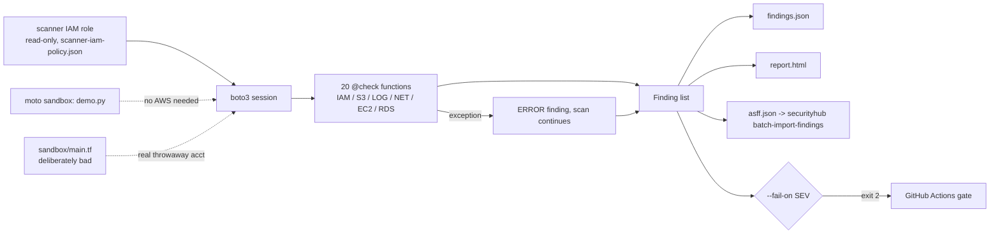

# MiniCSPM-AWS — 20 CIS AWS Foundations checks in ~300 lines of boto3

> **Lab project.** All results below come from a **moto-mocked** AWS account, not a real one.

## Problem
Commercial CSPMs (Wiz, Prisma, Security Hub CSPM) are a black box to a fresher. I wanted to understand what a posture check really is: a read-only API call plus a rule mapped to a CIS control. MiniCSPM runs 20 checks across IAM, S3, CloudTrail, VPC, KMS, EC2 and RDS. It writes **JSON, HTML and AWS Security Hub ASFF** output and can fail CI on a chosen severity.

## Architecture


## Checks
| ID | CIS v3 | Check | Sev |
|---|---|---|---|
| IAM-01/02 | 1.4 / 1.5 | Root access keys absent, root MFA | CRITICAL |
| IAM-03/04 | 1.8 / 1.9 | Password policy length ≥14, reuse 24 | MED/LOW |
| IAM-05 | 1.10 | MFA for console users | HIGH |
| IAM-06 | 1.14 | Access keys ≤90 days | MED |
| IAM-07 | 1.15 | Permissions only via groups | LOW |
| IAM-08 | 1.16 | No `*:*` customer policies | HIGH |
| S3-01/02/03 | 2.1.4 / 2.1.1 / 2.1.2 | Block Public Access, deny non-TLS, versioning | HIGH/MED/LOW |
| LOG-01/02 | 3.1 / 3.2 | Multi-region trail logging, log validation | HIGH/MED |
| LOG-03/04 | 3.7 / 3.6 | VPC flow logs, KMS rotation | MED |
| NET-01/02 | 5.2 / 5.4 | No world→22/3389 (v4 + v6), default SG empty | HIGH/LOW |
| EC2-01 | 2.2.1 | EBS encryption by default | MED |
| RDS-01/02 | 2.3.3 / 2.3.1 | RDS not public, storage encrypted | HIGH |

CIS numbers follow CIS AWS Foundations v3.0 as I understand it. Check them against the official PDF before quoting them in a report.

## Run
```bash
python3 -m venv .venv && .venv/bin/pip install -r requirements-dev.txt
.venv/bin/pytest -q
python -m minicspm.demo --out results          # moto sandbox, no AWS account
# real account (read-only role with scanner-iam-policy.json):
AWS_PROFILE=audit python -m minicspm.cli --region ap-south-1 --out out --fail-on HIGH
aws securityhub batch-import-findings --findings file://out/asff.json   # optional (max 100 per call)
```

## Results (actual run, 2026-10-11, moto 5 locally)
- `pytest`: **8 passed** in 4.7 s. Tests cover an empty account, the bad/good sandbox, port edge cases (443 open passes, IPv6 all-traffic fails), error containment, ASFF shape and the CLI exit code.
- Sandbox scan (`results/`): **25 resource evaluations, 12 PASS, 13 FAIL, 0 ERROR**. Failures: 1 CRITICAL (root MFA, which moto reports as off), 6 HIGH (console user without MFA, `*:*` policy, public-capable bucket, SSH open to the world, public RDS, unencrypted RDS), 3 MEDIUM, 3 LOW.
- Each planted misconfiguration was detected, and each "good" control (password policy, TLS-deny bucket, validated multi-region trail, rotated key, EBS default encryption) passed.

## Limitations
- **I have not run it against a real AWS account.** moto doesn't model everything. For example, root MFA/keys come from moto's fixed account summary, and `get_trail_status` is simplified.
- No pagination yet. Accounts with more than 100 users, policies or SGs will be under-scanned. Single region only.
- 20 of the roughly 60 CIS controls. No CloudWatch metric-filter controls (CIS 4.x), Config, GuardDuty or Access Analyzer.
- IAM-08 only checks `Action:"*"` + `Resource:"*"`. It misses `iam:*` and NotAction tricks.
- `sandbox/main.tf` is untested (`terraform` isn't installed on my lab machine).

## Sources
- CIS Amazon Web Services Foundations Benchmark v3.0 — https://www.cisecurity.org/benchmark/amazon_web_services
- AWS Security Finding Format (ASFF) — https://docs.aws.amazon.com/securityhub/latest/userguide/securityhub-findings-format.html
- moto `mock_aws` — https://docs.getmoto.org/
- Inspiration: https://github.com/clay-good/mantissa-stance

## Related work

This is my own implementation. Ideas came from [clay-good/mantissa-stance](https://github.com/clay-good/mantissa-stance).
